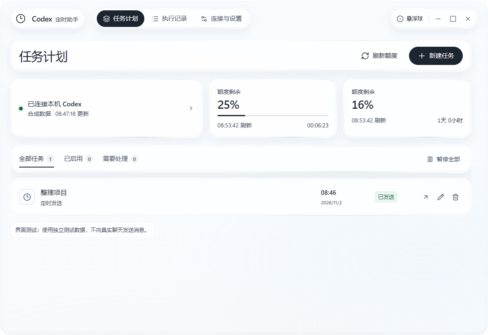
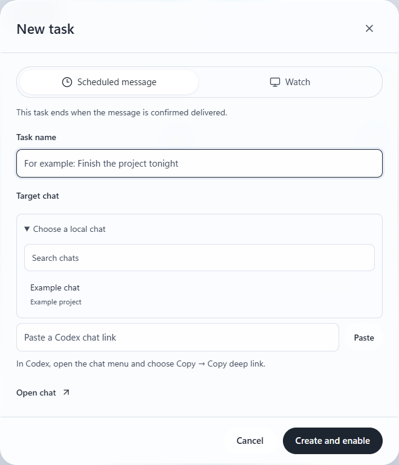
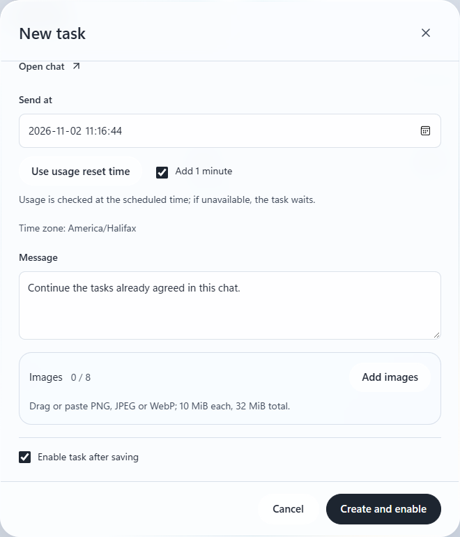
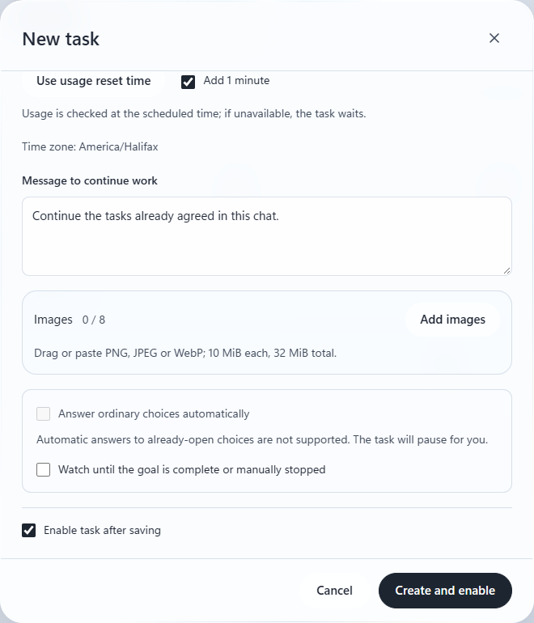

<h1 align="center">Codex Timer Assistant</h1>
<p align="center">Schedule Codex messages and watch chats on Windows.</p>
<p align="center"><a href="README.md">中文</a> · <strong>English</strong></p>



The screenshot uses sample data. This is an independent third-party application, not an OpenAI product. It uses your existing Codex sign-in and does not require a separate model API key.

## Download

Install and sign in to the Codex desktop app. Download the Windows x64 archive from [Releases](https://github.com/huang12chen/codex-timer-assistant/releases), extract it, and run the application. Under **Settings**, check the connection and time zone; if Codex is not detected, select the local `codex.exe` in connection details.

## How to use

### 1. Choose a chat

Select **New task**, choose **Scheduled message** or **Watch**, and enter a task name. Select a local chat or paste its Codex deep link.



### 2. Set the time and message

Set when to run and what to send. **Use usage reset time** fills in the reset time, with a one-minute delay selected by default; you can change it. Leave **Enable task after saving** checked and select **Create and enable**.



### 3. Set up a watch

Choose **Watch** to set a start time, end time, and message for continuing work. You can also watch until the goal is complete or you stop it manually. The assistant stops watching after an explicit completion confirmation.



Keep the computer awake and unlocked. Closing the window leaves the assistant in the tray; quitting it stops future scheduling.

The interface language and time zone initially follow the system and can be changed in Settings. Drag the floating timer, click it to open the window, or right-click it to hide it. If it does not appear, quit the assistant and start it with `Try-Software-Rendering.cmd` from the archive.

## Features and limits

- **Scheduled messages:** send text and up to eight PNG, JPEG, or WebP images to a selected chat. Actual image delivery and model understanding still need physical verification.
- **Watch:** observe the selected chat and continue according to quota and chat state; stop when the goal is explicitly confirmed complete. The assistant does not independently verify work quality. Long-running behavior depends on the environment.
- **Quota and history:** view usage and reset countdowns; filter, export, or clear history. The latest 500 records are retained by default.
- **Manual attention:** approval requests and already-open choices require you. Uncertain sends are not automatically repeated. After verifying delivery in the target chat, select **Confirm delivered** on the task.

The executable is unsigned. English Windows and other computer configurations have not all been tested. Codex updates may change quota, client interfaces, or window behavior.

## Data and development

Tasks and history are stored under `%APPDATA%\CodexTimerAssistant`, separately from the application; the `.bak` backup may retain older records. The assistant does not store your Codex account password or token. `Ctrl + Alt + Shift + S` pauses future operations.

Node.js 22.12 or later is required to run from source:

```powershell
npm install
npm test
npm start
```

See [THIRD-PARTY-NOTICES.md](THIRD-PARTY-NOTICES.md) for third-party notices and [LICENSE](LICENSE) for the project license.
