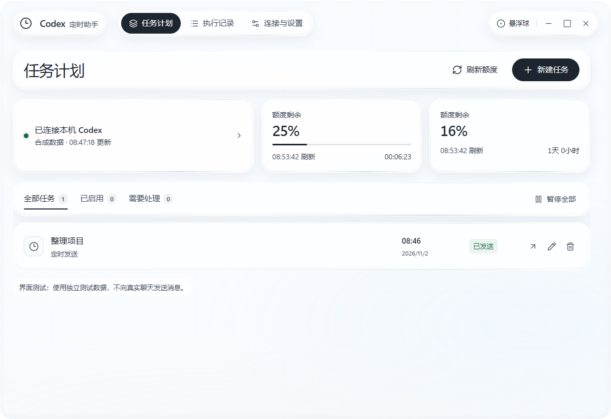

<h1 align="center">Codex 定时助手</h1>
<p align="center">在 Windows 上定时发送 Codex 消息，并按设定条件持续看守聊天。</p>
<p align="center"><strong>中文</strong> · <a href="README.en.md">English</a></p>



界面截图使用模拟数据。此工具是独立的第三方应用，不属于 OpenAI，也不需要额外的模型 API 密钥。

## 下载与使用

1. 安装并登录 Codex 桌面应用，打开需要操作的聊天。
2. 从 [Releases](https://github.com/huang12chen/codex-timer-assistant/releases) 下载 Windows x64 压缩包，解压后运行程序。
3. 在「连接与设置」确认连接和时区；如未找到 Codex，可在连接详情中选择本机 `codex.exe`。
4. 点击「新建任务」，选择本机聊天，设置定时发送或持续看守。可以使用额度刷新时间，并选择延后一分钟。
5. 保持电脑开机、未锁屏且不休眠。关闭主窗口后助手仍在托盘；退出助手会停止后续调度。

默认跟随系统时区和界面语言，之后可在设置中调整。悬浮球可拖动、点击打开主窗口，右键可关闭。若悬浮球不显示，可先退出助手，再使用压缩包中的 `Try-Software-Rendering.cmd` 启动。

## 功能与限制

- **定时发送**：到时向固定聊天发送文字，可选择、拖入或粘贴最多 8 张 PNG、JPEG 或 WebP 图片。图片实际送达和模型理解仍需实测。
- **持续看守**：观察所选聊天，根据额度和聊天状态继续工作；收到明确的目标完成确认后停止。助手不独立判断工作质量。长时间运行仍需根据实际环境验证。
- **额度与记录**：显示可用额度及刷新倒计时；执行记录可筛选、导出和清空，默认保留最近 500 条。
- **人工处理**：权限请求和已弹出的选择题需要本人处理。发送结果不确定时不会自动重发；核实目标聊天已收到后，可在任务中选择「确认已送达」。

程序目前没有数字签名；英文 Windows 和不同电脑环境尚未全部实测。额度、客户端接口和窗口行为可能随 Codex 更新而变化。

## 数据与源码

任务和记录保存在 `%APPDATA%\CodexTimerAssistant`，与程序文件分开；备份 `.bak` 可能保留旧记录。程序不保存 Codex 账户密码或令牌。快捷键 `Ctrl + Alt + Shift + S` 暂停全部后续操作。

源码运行需要 Node.js 22.12 或更新版本：

```powershell
npm install
npm test
npm start
```

第三方许可见 [THIRD-PARTY-NOTICES.md](THIRD-PARTY-NOTICES.md)，项目许可见 [LICENSE](LICENSE)。
